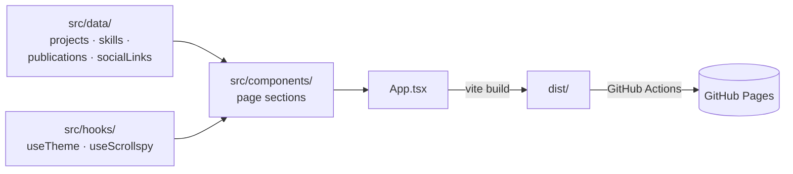

# Portfolio

My personal portfolio site: who I am, what I work with, what I've built and written, and how to reach me. A single-page React app with a light/dark theme, deployed to GitHub Pages.

**Live:** https://iamagk.github.io/portfolio/

## What's on the page

| Section | Component | Content from |
|---|---|---|
| Header with section links | `Header.tsx` | Highlights the current section as you scroll (`useScrollspy`) and toggles light/dark (`useTheme`) |
| Hero | `HeroSection.tsx` | Name and intro |
| About | `AboutSection.tsx` | Photo, background and a résumé download (`src/assets/resume.pdf`) |
| Skills | `SkillsSection.tsx` | `src/data/skills.ts`: languages, frontend, databases, tools |
| Projects | `ProjectsSection.tsx` | `src/data/projects.ts`: ML, fintech and web projects with tech tags and demo links |
| Publications | `PublicationsSection.tsx` | `src/data/publications.ts` |
| Contact and footer | `ContactSection.tsx`, `Footer.tsx` | `src/data/socialLinks.ts`: GitHub, LinkedIn, email |

## How it fits together



To update the content (a new project, skill or publication), edit the matching file in `src/data/`. The components don't need to change.

## Running it

```bash
npm install
npm run dev        # http://localhost:5173/portfolio/
npm run build      # production build into dist/
npm run preview    # serve the build locally
```

## Deployment

Every push to `main` runs `.github/workflows/deploy.yml`, which builds the site and publishes `dist/` to GitHub Pages. `vite.config.ts` sets `base: '/portfolio/'` to match the repo name, so change it if the repo is renamed.

You can also deploy by hand with `npm run deploy`, which uses `gh-pages`.

## Tech stack

React 18 · TypeScript · Vite · Tailwind CSS · lucide-react · GitHub Actions · GitHub Pages
